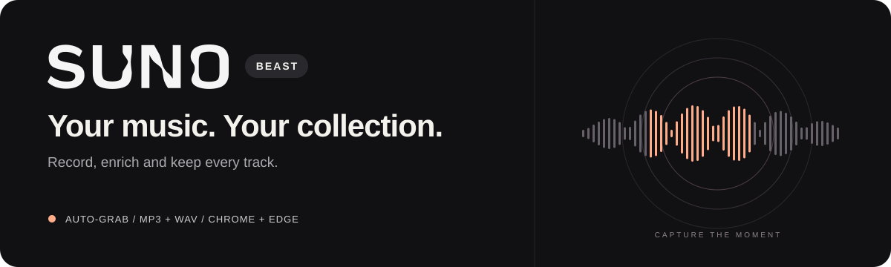
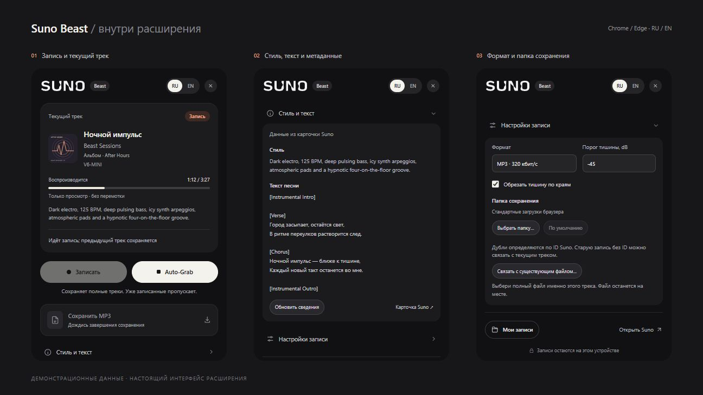

<p align="center">
  
</p>

<p align="center">
  <a href="LICENSE"></a>
  
  
  
  
</p>

<p align="center">
  <b>Записывай Suno. Собирай свою коллекцию.</b><br>
  Полные треки, настоящие обложки и метаданные — в обычном Chrome или Edge.
</p>

<p align="center">
  <a href="#возможности">Возможности</a> ·
  <a href="#установка">Установка</a> ·
  <a href="#как-пользоваться">Как пользоваться</a> ·
  <a href="#вопросы-и-решения">Вопросы и решения</a> ·
  <a href="#поддержать-проект">Поддержать проект</a>
</p>

## Возможности

Suno Beast добавляет к Suno компактную панель записи. Браузер захватывает звук вкладки, а локальный помощник с FFmpeg обрабатывает его и сохраняет готовые файлы.

| | Что умеет расширение |
| :--- | :--- |
| **Auto-Grab** | Записывает полные треки и разделяет их при автопереходе. Уже сохранённые генерации пропускает. |
| **Ручная запись** | Позволяет сохранить выбранный фрагмент кнопками «Записать» / «Остановить». |
| **MP3 и WAV** | MP3 320 кбит/с, WAV 24 бит, обрезка тишины по краям. Прямое сохранение MP3 доступно при обнаружении потока. |
| **Карточка трека** | Обложка, название, исполнитель, доступный альбом, модель и время. Индикатор прогресса без перемотки. |
| **Метаданные** | Стиль и текст из карточки Suno; теги и обложка в MP3, поддерживаемые текстовые поля в WAV. |
| **Своя коллекция** | Проверка дублей по ID Suno и привязка уже существующего файла к треку. |
| **Удобное сохранение** | Стандартные загрузки браузера или выбранная папка. Интерфейс на русском и английском. |

## Интерфейс

<p align="center">
  
</p>

На скриншотах — настоящий интерфейс расширения с демонстрационными данными.

## Совместимость

**Расширение создавалось и тестировалось на Windows.** Предназначено для Chrome и Edge. macOS и Linux не тестировались; установка локального помощника рассчитана на Windows.

Для работы нужны:

- **Chrome или Edge 116+**. Рекомендуется актуальная версия; оформление списка форматов поддерживается начиная с Chromium 135.
- **[Node.js](https://nodejs.org/en/download)** с npm.
- **[FFmpeg и ffprobe](https://ffmpeg.org/download.html)**, доступные в `PATH`.

## Установка

### 1. Скачать проект

Скачай архив через **Code → Download ZIP** на [странице репозитория](https://github.com/Lotargo/suno_beast) и распакуй его в постоянную папку. Или используй Git:

```powershell
git clone https://github.com/Lotargo/suno_beast.git
cd suno_beast
```

Сборка расширения и `npm install` не требуются.

### 2. Подключить аудиопомощник

Открой PowerShell в корне распакованного проекта. Проверь, что установленные инструменты доступны:

```powershell
node --version
npm --version
ffmpeg -version
ffprobe -version
```

Затем выполни:

```powershell
npm run install:helper
```

Команда регистрирует локальный аудиопомощник для Chrome и Edge. Права администратора не нужны. Помощник запускается браузером по необходимости через [Native Messaging](https://developer.chrome.com/docs/extensions/develop/concepts/native-messaging).

### 3. Загрузить расширение в браузер

1. Открой `chrome://extensions` в Chrome или `edge://extensions` в Edge.
2. Включи **Режим разработчика**.
3. Нажми **Загрузить распакованное расширение**.
4. Выбери **папку `extension` внутри проекта** — в ней находится `manifest.json`.
5. Закрепи Suno Beast в панели браузера через меню расширений.
6. Открой [suno.com](https://suno.com), войди в аккаунт обычным способом и нажми кнопку Suno Beast.

Оставь папку проекта на месте: браузер и аудиопомощник используют файлы из неё.

## Как пользоваться

### Записать несколько треков

Включи **Auto-Grab до начала воспроизведения**, затем запусти трек с начала в Suno. Расширение сохранит его после естественного завершения и продолжит запись следующего. Обработка предыдущего файла идёт отдельно.

Если включить Auto-Grab посреди песни, он дождётся следующего старта с начала. Пауза в Suno дольше 1,2 секунды, перемотка или переключение незавершённого трека отменяют текущий фрагмент — обрывок не попадает в готовую коллекцию.

### Сохранить фрагмент или прямой MP3

- **Записать → Остановить** — ручная запись; остановка кнопкой расширения сохраняет выбранный фрагмент.
- **Сохранить MP3** — сохранение обнаруженного прямого аудиопотока. Кнопка становится доступна, когда найден подходящий адрес и нет активной записи.

Закрытие панели не останавливает запись. Закрытие вкладки или уход с Suno прекращает захват.

### Выбрать формат и папку

Открой **Настройки записи**: выбери MP3 или WAV, обрезку тишины и порог. По умолчанию файлы отправляются в **стандартные загрузки браузера**. **Выбрать папку…** включает сохранение в другую папку; **По умолчанию** возвращает загрузки браузера.

Папку меняй после окончания записи и обработки. Ранее сохранённые файлы остаются на своих местах.

### Обложки, текст и дубли

**Стиль и текст** раскрывает сведения о текущей песне. В MP3 сохраняются доступные обложка, текст, стиль, альбом, модель и ссылка на источник. В WAV — поддерживаемые текстовые поля без встроенной обложки.

Auto-Grab проверяет коллекцию по **точному ID Suno**: одинаковые названия у разных генераций не мешают записи. Ручной фрагмент не блокирует последующую полную запись. Старый полный файл можно добавить в коллекцию через **Связать с существующим файлом…** — файл не переписывается.

Запись захватывает весь звук вкладки и проходит через WebM Opus с последующим преобразованием. Выбор WAV не повышает качество исходного звука. Прямой MP3 при отключённой обрезке сохраняется без перекодирования.

## Вопросы и решения

| Ситуация | Что сделать |
| :--- | :--- |
| Помощник не подключён | Проверь Node.js, FFmpeg и ffprobe в `PATH`, выполни `npm run install:helper` из папки проекта и перезапусти браузер. |
| PowerShell блокирует `npm.ps1` | Используй `npm.cmd run install:helper`. |
| Установщик пишет `A different host is already registered` | Зарегистрирована другая копия. Запусти `native/uninstall.ps1` из старой папки, затем установи помощник из новой. |
| После обновления видно старое поведение | На странице расширений нажми кнопку перезагрузки карточки Suno Beast, затем снова открой панель. |
| MP3-кнопка недоступна | Прямой поток ещё не обнаружен. Используй запись вкладки. |
| Auto-Grab пропускает текущую песню | Проверь, что трек запущен с начала и его полная запись ещё не существует в коллекции. |
| Загрузка отменена | Готовый файл остаётся в `%LOCALAPPDATA%\SunoBeast\pending`; путь отображается в панели. |

**Обновление.** Закончи запись, обнови файлы проекта и перезагрузи расширение на странице управления. После перезапуска включи Auto-Grab заново.

**Удаление.** Удали расширение в браузере. Для удаления регистрации аудиопомощника выполни из корня проекта:

```powershell
powershell -NoProfile -ExecutionPolicy Bypass -File .\native\uninstall.ps1
```

Записи и настройки сохраняются. Настройки и индекс коллекции находятся в `%LOCALAPPDATA%\SunoBeast`.

## Локальная обработка

Аудио обрабатывается на компьютере через FFmpeg. Расширение работает на страницах Suno и использует его CDN для аудио и обложек. Метаданные читаются из публичной карточки песни; доступа к паролям, cookies и истории браузера нет.

Пользователь самостоятельно несёт ответственность за использование расширения.

## Разработка

Расширение не требует сборки и сторонних npm-зависимостей. Структура проекта, проверки и воспроизводимый предпросмотр описаны в **[руководстве разработчика](docs/DEVELOPMENT.md)**.

```powershell
npm test
```

## Поддержать проект

Если Suno Beast оказался полезен, можно оставить пожертвование в знак благодарности 🧡

<a href="https://yoomoney.ru/to/4100115195239085"></a>

Кошелёк ЮMoney: **`4100115195239085`**

## Лицензия

Код распространяется по лицензии **[MIT](LICENSE)**. Источники графических ресурсов указаны в [описании ассетов](extension/assets/README.md); название и логотип Suno принадлежат их правообладателю.
